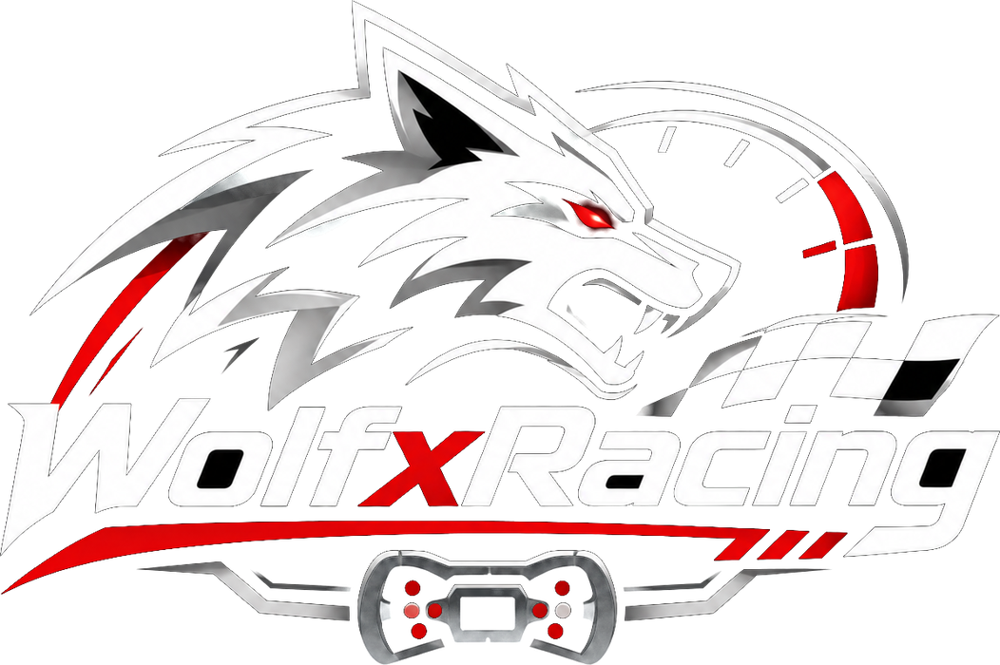
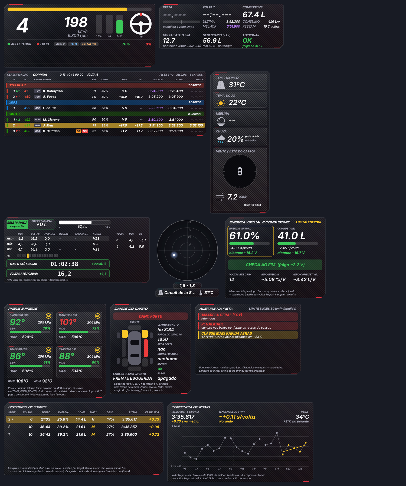
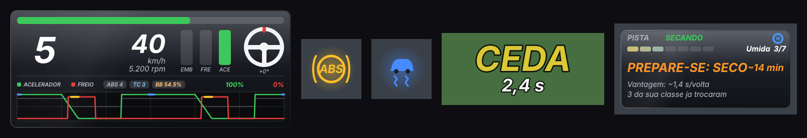
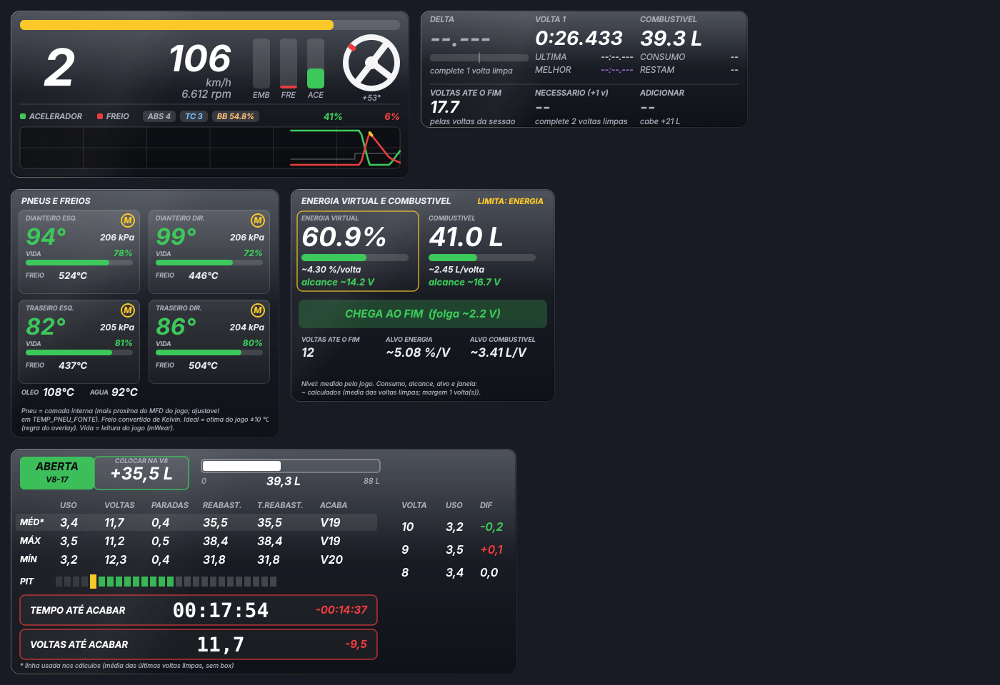
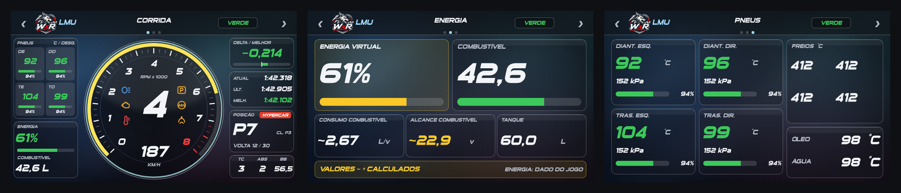
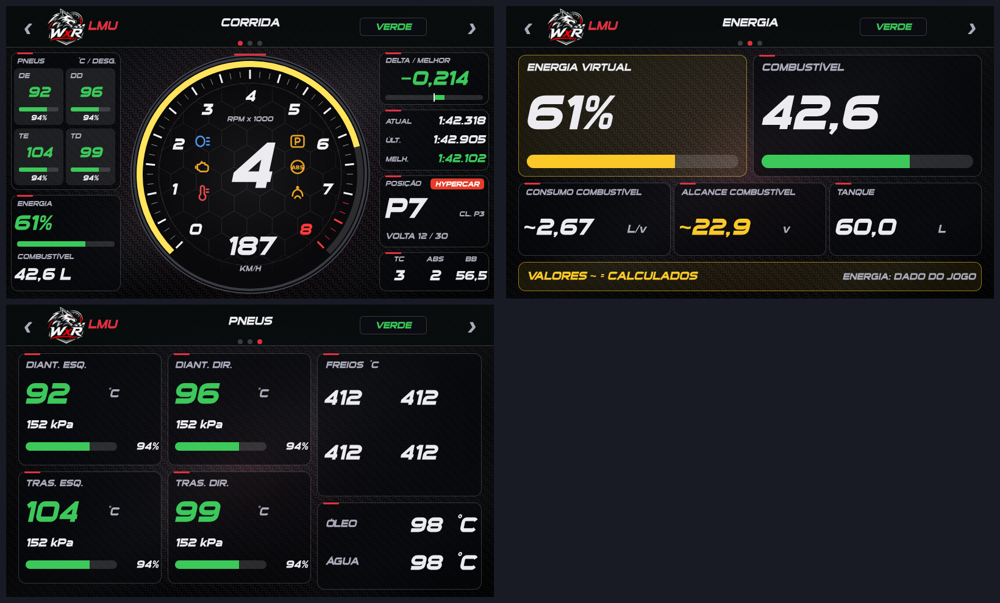

# WolfxRacing Overlay para Le Mans Ultimate

Overlay gratuito e de código aberto para **Le Mans Ultimate (LMU)** no Windows, com **23 janelas** independentes, **dash para o Simagic MagicDash 4** (SimHub) e **perfil de Stream Deck XL**.

> Projeto da comunidade, sem vínculo com à Motorsport Games, Studio 397 ou ACO, Simagic, SimHub ou Elgato. Marcas pertencem aos seus donos. O overlay **não injeta código no jogo**: lê apenas a telemetria que o próprio jogo disponibiliza.

## O que tem aqui

| Pasta | Conteúdo |
|---|---|
| [`overlay/`](overlay) | O overlay (Python + PySide6): 23 janelas, perfis, atalhos globais, testes automáticos |
| [`dash/`](dash) | Dash **MagicDash 4** nos estilos **Glass Fumê** e **Sport** (`.simhubdash`, 3 telas, 800x480) + ferramentas para gerar/alterar |
| [`streamdeck/`](streamdeck) | Perfil para **Stream Deck XL**, biblioteca de ícones e gerador |
| [`docs/`](docs) | Manual, guia do dash, guia do Stream Deck, arquitetura e histórico |

## Novidades da 1.2.0

A janela **Telemetria** ganhou o gráfico de pedais por tempo (5 a 30 s, com degraus da marcha e marcas de ABS/TC) e há quatro janelas novas: **Luz do ABS**, **Luz do TC** (as duas com dado do próprio jogo), **Retorno à pista** (PARE / CEDA / LIVRE com os segundos até o carro de trás chegar) e **Estratégia de pneus** (chuva x seco). Veja o [manual](docs/MANUAL.md#13-luz-do-abs) e o [CHANGELOG](CHANGELOG.md).

## Estilos visuais: Glass Fumê e Sport

O overlay e o dash têm dois estilos. **Glass Fumê** (novo, padrão) é um vidro escuro translucido, com reflexo suave e bordas finas; **Sport** usa fibra de carbono e detalhes vermelhos. Os dois têm a **tipografia esportiva** (texto itálico, Sui Generis nos títulos). No overlay, troque em *bandeja > Estilo Glass Fumê / Estilo Sport*. No dash, importe o arquivo `Glass` ou `Sport`.

### Dash MagicDash 4 Glass Fumê

### Dash MagicDash 4 Sport

## Início rápido

> Baixou o zip? Leia primeiro o **COMECE_AQUI.txt** (texto simples, 2 minutos).

1. Baixe o `.zip` da página de [Releases](../../releases) e extraia dentro de `C:\WolfxRacing` (o zip cria a pasta `wolfxracing-overlay-lmu`; recomendado; o perfil do Stream Deck assume este caminho, mas dá para ajustar).
2. Dê duplo clique em **`overlay\instalar_lmu.bat`** (uma vez) e depois em **`overlay\testar_demo_lmu.bat`** para ver o overlay funcionando com dados simulados.
3. Configure o jogo e abra o overlay com **`overlay\iniciar_overlay_lmu.bat`**.
4. Dash: dê duplo clique em `dash\MagicDash4 LMU Glass.simhubdash` (ou `...Sport.simhubdash`; o SimHub importa).
5. Stream Deck (opcional): importe `streamdeck\Overlay LMU.streamDeckProfile`.

Passo a passo completo e com prints: **[docs/MANUAL.md](docs/MANUAL.md)**.

## Requisitos

- Windows 10/11 (64 bits).
- Python **3.12** (64 bits) com `PySide6-Essentials` (o `instalar_lmu.bat` faz isso). Não precisa de plugin nem DLL: o overlay lê a memória compartilhada do jogo (a biblioteca `pyLMUSharedMemory` já vem no pacote).
- LMU com **Settings > Gameplay > Enable Plugins** ligado e vídeo em **Window** ou **Borderless** (não *Fullscreen*).
- Dash: SimHub (testado com 9.x) e um Simagic MagicDash 4 (ou qualquer tela 800x480 do SimHub).
- Stream Deck: modelo XL (32 teclas).

## Documentação

- [Manual do usuário](docs/MANUAL.md) · [Dash](docs/DASH.md) · [Stream Deck](docs/STREAMDECK.md)
- [Arquitetura (para quem quer contribuir)](docs/ARQUITETURA.md) · [Como contribuir](CONTRIBUTING.md) · [Histórico de versões](CHANGELOG.md)
- [Histórico do desenvolvimento](docs/historico)

## Contribuindo

Melhorias são muito bem-vindas: abra uma *Issue* com o problema ou a ideia, ou envie um *Pull Request*. Leia o [CONTRIBUTING](CONTRIBUTING.md) (como rodar os testes, padrões e o que **não** incluir, como logos de marcas).

## Licença

[MIT](LICENSE). Componentes de terceiros e avisos em [NOTICE.md](NOTICE.md).

---
**English summary:** free, open-source overlay for Le Mans Ultimate (LMU) (Windows, Python/PySide6) with 12 windows, a SimHub dash for the Simagic MagicDash 4 and a Stream Deck XL profile. Documentation is in Brazilian Portuguese; contributions in English or Portuguese are welcome.
