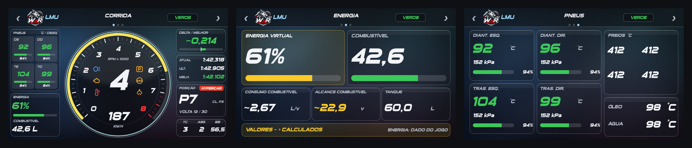
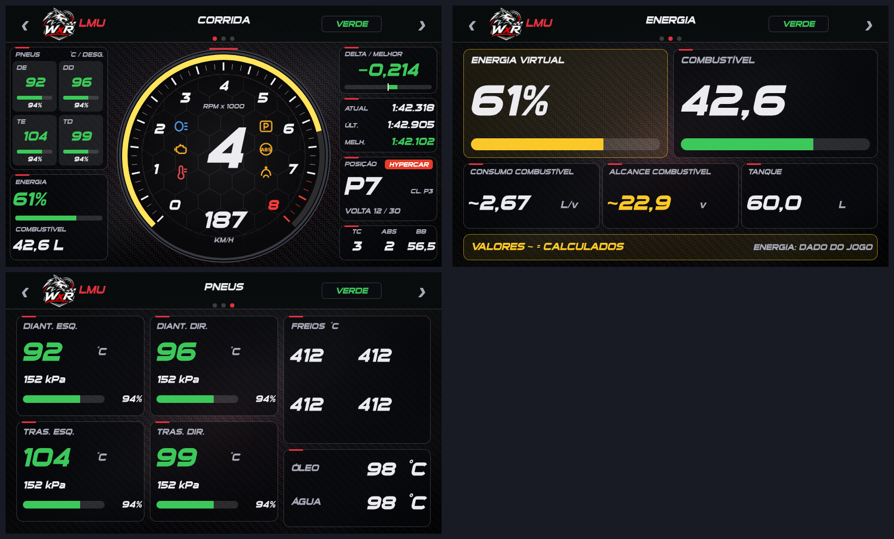
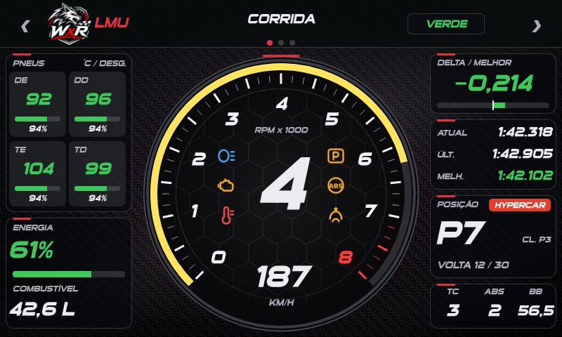
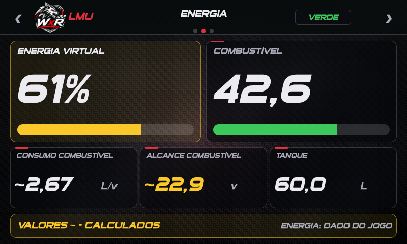
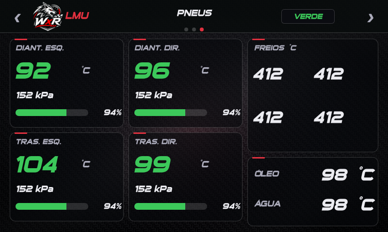

# Dash MagicDash 4 (Glass Fumê e Sport) para Le Mans Ultimate (LMU)

Dash para o **Simagic MagicDash 4** (800x480, tela de toque) feito no SimHub (Dash Studio), em dois estilos: **Glass Fumê** (vidro escuro translúcido, tipografia esportiva Sui Generis e acento azul gelo; novo) e **Sport** (painel de carro esportivo): fundo de fibra de carbono, fonte inclinada **Sui Generis** (já vem com o SimHub), detalhes vermelhos e luzes de aviso dentro do tacômetro.





> O cabeçalho traz o emblema **WolfxRacing** e o nome do jogo em texto. Os prints são **prévias com dados de exemplo**, geradas fora do SimHub; o dash real pode ter pequenas diferenças. Os logos oficiais do jogo **não** são distribuídos (marcas registradas): no lugar fica o emblema WolfxRacing, com o nome do jogo em texto.

## Instalação

1. Requisitos: SimHub 9.x (testado com 9.13) e o MagicDash 4 configurado no SimHub.
2. Dê **duplo clique** em `dash/MagicDash4 LMU Glass.simhubdash` (ou no `Sport`): o SimHub importa o dash (ou: *Dash Studio > Import/Add dashboard*).
3. Em *Dash Studio*, selecione **MagicDash4 LMU Glass** (ou Sport) como *Main dashboard* do MagicDash 4.
4. Reimportar sobrescreve a versão anterior.

## Navegação

O SimHub não tem gesto de deslizar: toque na **metade esquerda do cabeçalho** para a tela anterior e na **metade direita** para a próxima (com volta ao início). Os pontos no cabeçalho indicam a tela atual.

## Telas

### Tela 1: Corrida



Tacômetro central com marcha, velocidade e RPM x1000, **6 luzes de aviso** (farol, motor, temperatura, limitador de boxes, ABS e TC), pneus (temperatura e desgaste), **energia virtual** e combustível, delta/melhor, tempos, **posição na classe** com chip da classe (Hypercar/LMP2/LMGT3...) e ajustes de TC, ABS e balanço de freio.

### Tela 2: Energia



Energia virtual e combustível lado a lado (barras), consumo, alcance em voltas e tanque.

### Tela 3: Pneus



Quatro pneus com temperatura, pressão e vida; temperatura dos freios; óleo e água.

## Notas

- **Posição na classe:** o SimHub não expõe a posição na classe do LMU. O dash usa o plugin **Lovely** (`LovelyPlugin.TeamLINQ.Opponents`) e, se existir, o NeoRed; sem eles mostra apenas a posição geral ("GERAL P#"). Confirmado com Lovely instalado.
- **Energia virtual** vem de `GameRawData.PlayerNativeTelemetry.mVirtualEnergy` (0 a 1).
- **Luz do motor:** acende com o motor superaquecendo, motor parado (ignição ligada sem rotação, igual à luz do painel do jogo) ou peça solta. **Farol:** lido do jogo.
- Valores com `~` são calculados/estimados; sem `~` são medidos pelo jogo.
- Em itens sem dado do jogo o dash mostra `--` (nada é inventado).

## Alterar ou gerar o dash

O `.simhubdash` é gerado por scripts Python em [`dash/tools`](../dash/tools) (requer `pillow`, `numpy`; `playwright` só para as prévias):

```text
cd dash/tools
python bg_sport.py && python bg_sport2.py   # fundos (opcional: já vêm em assets_sport/)
python icons_sport.py                       # ícones das luzes (opcional)
python bg_vidro.py                          # fundos do Glass Fumê (opcional: já vêm em assets_vidro/)
python build_sport.py --so lmu --vidro      # gera out_vidro/MagicDash4 LMU Glass.simhubdash
python build_sport.py --so lmu              # gera out_sport/MagicDash4 LMU Sport.simhubdash
python check_sport.py                       # valida o resultado
```

Opções do `build_sport.py`: `--so iracing|lmu|todos`, `--vidro` (estilo Glass Fumê; sem a opção, gera o Sport) e `--com-logos` (somente para **uso pessoal**: troca o emblema WolfxRacing pelo logo do jogo; coloque o seu `MD4_logo_<jogo>.png` em `assets_sport/`; não publique o resultado). As expressões (JavaScript do SimHub) ficam em `js_sport/`: `MD4_alertas.js` (luzes, posição, energia), `MD4_lmu_temps.js` (pneus).

Dicas de desenvolvimento: abra o dash no navegador em `http://127.0.0.1:8888/Dash?r=1#<NomeDoDash>` (SimHub em execução) para ver as telas ao vivo e testar `$prop(...)` nas expressões.
