# Manual do usuário: WolfxRacing Overlay para Le Mans Ultimate

> Versão do overlay neste pacote: **LMU 1.2.0 (estilos Glass Fumê e Sport + gráfico de pedais, Luz ABS, Luz TC, Retorno à pista e Estratégia de pneus)**. Os prints foram gerados no **modo demonstração** (dados simulados); as fontes e as medidas podem variar um pouco no seu Windows.

## Sumário

1. [O que é](#1-o-que-é) · 2. [Instalação](#2-instalação-uma-única-vez) · 3. [Configurar o jogo](#3-configurar-o-le-mans-ultimate-obrigatório) · 4. [Uso diário](#4-uso-diário) · 5. [As 23 janelas](#5-as-janelas) · 6. [Como ler os números](#6-como-ler-os-números) · 7. [Dash e Stream Deck](#7-dash-e-stream-deck) · 8. [Solução de problemas](#8-solução-de-problemas) · 9. [Atualizar](#9-atualizar-para-uma-versão-nova) · 10. [Limites](#10-limites-conhecidos)

## 1. O que é

23 janelas independentes e transparentes, sempre por cima do jogo, que podem ser movidas, redimensionadas e ligadas/desligadas pelo menu do ícone azul "LM" perto do relógio do Windows. Tudo roda localmente; nenhum dado seu é enviado para a internet.

## 2. Instalação (uma única vez)

1. **Python 3.12.** Instale o *Python Install Manager* em [python.org/downloads](https://www.python.org/downloads/).
2. **Extraia** o `.zip` dentro de `C:\WolfxRacing` (o zip já cria a pasta `wolfxracing-overlay-lmu`; o resultado é `C:\WolfxRacing\wolfxracing-overlay-lmu`). Outra pasta também funciona, mas veja o aviso do Stream Deck em [STREAMDECK.md](STREAMDECK.md).
3. Dê duplo clique em **`overlay\instalar_lmu.bat`**. Ele prepara o Python 3.12 e instala `PySide6-Essentials`. O LMU **não** usa `pyirsdk`.
4. Teste sem o jogo: **`overlay\testar_demo_lmu.bat`** (dados simulados). Procure o ícone azul "LM" perto do relógio (seta `^`).

Instalação manual (alternativa): `py -3.12 -m pip install PySide6-Essentials`.

## 3. Configurar o Le Mans Ultimate (obrigatório)

1. No LMU: **Settings > Gameplay > Enable Plugins = LIGADO** (o overlay lê a memória compartilhada do jogo; não precisa instalar plugin nem DLL no Windows). Reinicie o jogo depois.
2. Vídeo em **Window** ou **Borderless**. Em **Fullscreen** (tela cheia exclusiva) o Windows esconde qualquer overlay: não é defeito do programa. Reinicie o jogo depois de trocar.
3. O overlay pode ser aberto antes ou depois do jogo. Sem sessão ele mostra "Aguardando o Le Mans Ultimate..." (jogo fechado, sem sessão ou *Enable Plugins* desligado).

## 4. Uso diário

1. Abra **`overlay\iniciar_overlay_lmu.bat`**.
2. **Posicionar:** clique com o botão direito no ícone azul "LM" e **desmarque "Travar posição"**. Arraste cada janela (contorno amarelo = modo mover). Ao terminar, marque "Travar posição": as janelas aparecem sozinhas ao sentar no carro e somem nos menus.
3. **Redimensionar:** arraste as bordas/cantos ou use **Ctrl + roda do mouse**. A classificação é mais larga que as demais (~846x240 em 100%): ajuste na primeira vez.
4. **Primeira execução:** o layout inicial vem do layout padrão e depois é gravado em `config_lmu.json` (independente do iRacing, se você também usa o overlay dele).
5. **Visual:** *Visual moderno*, **Estilo Glass Fumê** (vidro escuro translúcido, padrão), **Estilo Sport** (itálico, cantos cortados, detalhes vermelhos) e *Transparência do fundo*. Desmarcar *Visual moderno* volta ao clássico.
6. **Manter o overlay por cima do jogo:** reafirma "sempre no topo" 10 vezes por segundo e na hora em que o foco muda.
7. **Diagnóstico:** `overlay\diagnostico_lmu.bat` (com o jogo aberto e no carro) grava `diagnostico_lmu.txt` com o que o overlay enxerga do jogo; anexe-o em Issues.
8. **Fechar:** *Sair* no menu da bandeja, `Alt+Shift+F20` (Stream Deck) ou, se travar, `overlay\fechar_overlay_lmu.bat`.

### Estilos visuais

Os dois estilos usam a tipografia esportiva (itálico; títulos em Sui Generis, se o SimHub estiver instalado). Glass Fumê e Sport não se combinam: ao marcar um, o outro desmarca. A *Transparência do fundo* vale para os dois (no Glass Fumê, valores entre 60% e 80% deixam o vidro mais evidente). O vidro é simulado com transparência e reflexos; o overlay não borra o que está atrás da janela.

## 5. As janelas

### 1. Telemetria

Marcha, velocidade, RPM, pedais, volante, TC, ABS, balanço de freio e **gráfico de acelerador/freio** (novo na 1.2.0: rola por tempo, de 5 a 30 s, com degraus da marcha, marca amarela do ABS no freio e marca azul do TC no acelerador).

- Ajustes em *bandeja > Telemetria: tempo do gráfico de pedais*, *degraus das marchas*, *marca do ABS* e *marca do TC*. As marcas de ABS e TC vêm do jogo, não são estimativa.
- Mesmo visual e posição das janelas do overlay de iRacing.

**Layout em barra (novo na 1.4.1):** no menu da bandeja, marque "Layout em barra horizontal (na telemetria)" para trocar o painel por uma barra de uma linha só (620 × 88 px, bem compacta): volante, marcha, velocidade, pedais e gráfico lado a lado. Embreagem em **azul**, freio em **laranja** e acelerador em **verde**, com o valor de 0 a 100 embaixo de cada pedal (colunas finas). Desmarque o gráfico e a barra encolhe para 292 px. Desmarcando o layout, volta o painel de sempre.

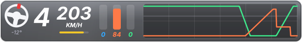

### 2. Voltas (delta)

Delta, tempos atual / última / melhor e cálculo de combustível.

- Em prova limitada pela **energia virtual**, olhe a janela Energia: esta janela calcula só pelos litros.

### 3. Classificação detalhada

Agrupada por Hypercar / LMP2 / LMGT3, com posição na classe, setas de posições ganhas/perdidas, número, marca, piloto, selos PIT/PEN/FIM/DNF/DSQ, paradas, combustível %, GAP, INT, melhor, última e média das últimas 5.

- GAP/INT em branco = medido pelo jogo; **cinza com "~"** = estimado pela posição na pista (há carro de outra classe entre os dois).
- Melhor volta em roxo = a melhor da classe. MED 5 ignora volta de largada, volta com box e volta muito lenta.

### 4. Clima

Temperatura da pista e do ar, chuva (com tendência), umidade da pista e vento.

- O LMU não informa o vento nem a neblina na memória compartilhada: mostram "--" (nada é inventado).

### 5. Combustível e pit

Medidor e calculadora: janela de pit, litros a colocar, autonomia e consumo.

- Calcula só pelos litros; para energia virtual, use a janela Energia.

### 6. Força G

Círculo de G lateral e longitudinal com rastro, G atual e pico.

### 7. Energia virtual e combustível

Energia virtual e combustível lado a lado, com barra, alcance (voltas) e destaque do recurso que **limita**; situação ("CHEGA AO FIM", "1 PARADA NECESSÁRIA..."), alvo de consumo por volta e voltas até o fim.

- Níveis são medidos pelo jogo; consumo, alcance, alvo e janela são calculados (marcados com "~").

### 8. Pneus e freios

Quatro cartões com temperatura, pressão, vida (%) e composto (S macio, M médio, H duro, W chuva), temperatura do freio, óleo e água.

- Verde = dentro da faixa ideal do jogo (±10 °C); azul = frio; vermelho = quente.
- A temperatura do pneu é a camada interna (mais próxima do MFD do jogo). Vida "--" = o jogo não entregou leitura para aquela roda.

### 9. Danos do carro

Carro visto de cima com 8 zonas (cinza = nenhum, amarelo = leve, vermelho = forte), rodas furadas/soltas, peça solta, motor (ok / superaquecendo / **parado**), **farol**, lado e força do último impacto.

- O LMU não informa % de dano nem tempo de reparo.

### 10. Alertas na pista

Até 6 avisos por gravidade (vermelho = perigo, amarelo = atenção, azul = informação): corrida parada, amarela geral (FCY), amarela local, bandeira azul, classe mais rápida atrás, carro lento/parado à frente, saída dos boxes, limitador, penalidade, motor superaquecendo, **motor parado**, pneu furado, peça solta e energia/combustível na reserva.

- Limiares (distâncias de aviso etc.) são definições do overlay, editáveis em `config_lmu.json`.

### 11. Histórico de stints

Por stint: voltas, tempo, energia e combustível gastos, pneu, desgaste, ritmo e diferença para a melhor volta.

- "*" = stint parcial (overlay aberto no meio do stint).

### 12. Tendência de ritmo

Gráfico das voltas limpas (stint atual em amarelo, reta de tendência, melhor volta em roxo), ritmo das últimas 5, tendência em s/volta e temperatura da pista.

- Volta limpa = sem box e dentro de 130% da melhor.

### 13. Luz do ABS

Um ícone solto, sem painel e sem texto, que **acende enquanto o ABS está atuando** e apaga quando ele para. No LMU o **jogo informa** quando o ABS atua (não é estimativa). Uma piscada curta no ponto de freada é o ABS trabalhando bem; acesa até o meio da curva, a freada passou do ponto.

- **Cor:** dourado (padrão), vermelho ou branco. **Como pisca:** *no ritmo do ABS* (padrão), *piscada suave* ou *luz fixa*.
- Quando não atua, a janela é **totalmente transparente**; para vê-la apagada marque *deixar visível e apagada quando não atua* ou use *Testar a Luz do ABS (5 s)* na bandeja (útil para posicionar).
- Carros sem ABS não acendem a luz (comportamento esperado).

### 14. Luz do TC (controle de tração atuando)

Ícone solto que **acende quando o controle de tração está cortando potência** (aviso do próprio jogo, `mTCActive`). No iRacing a mesma janela é uma estimativa; no LMU é dado do jogo.

- Mesmas opções de cor, piscada, "visível e apagada" e teste de 5 s da Luz do ABS (cor padrão azul).
- Acender muito = acelerador entrando cedo demais, ou o ajuste do TC do carro baixo demais para o piso.

### 15. Retorno à pista (PARE / CEDA / LIVRE)

Aparece quando você está **parado na pista ou com as quatro rodas fora dela** e mostra se pode voltar: **PARE** (vermelho), **CEDA** (laranja) ou **LIVRE** (verde), com os **segundos** até o carro mais próximo que vem atrás chegar até você. Some sozinho depois que você volta a andar.

- A velocidade de cada carro é medida ao vivo (avanço na pista); considera qualquer carro atrás de você, inclusive de outra classe. O LMU não informa a superfície dos outros carros: todos contam como "na pista".
- Não avisa nos boxes, no grid nem na volta de apresentação.
- Limites ajustáveis em *bandeja > Retorno*: vermelho abaixo de 1,5 s (padrão) e laranja abaixo de 3,5 s. *Deixar sempre visível enquanto piloto* e *Testar o aviso (9 s)* ajudam a posicionar.

### 16. Estratégia de pneus (chuva x seco)

Cartão que compara a **umidade da pista** e a **chuva** com o pneu montado e diz **SEGUIR**, **PREPARE-SE** (com minutos estimados quando a pista está secando) ou **TROCAR**. Antes da largada (e na garagem da classificação) mostra qual pneu largar.

- Usa a escala "pista molhada" de 1 a 7 do overlay (apoio visual, não medida oficial) e o composto do seu carro.
- **Limites no LMU:** o jogo não informa o pneu dos outros carros nem o pedido feito nos boxes, então **não há** "vantagem em s/volta" nem contagem de rivais (isso existe só no iRacing). A recomendação é pela pista e pelo seu pneu.
- Não mexe no carro nem pede pneu: só informa.

### 17. Curvas (velocidade mínima por curva) — novo na 1.4.0

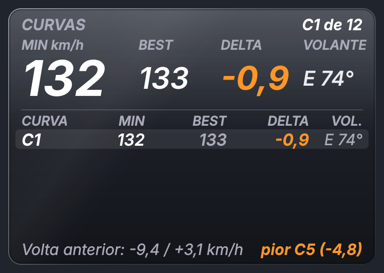

Mostra, para cada curva da pista, a **menor velocidade** que você fez e compara com a sua **melhor passagem** por ela. É a janela para descobrir **onde** a volta está sendo perdida: em qual curva, e quanto.

- **Cartão grande (última curva concluída):** **MIN** (menor velocidade nessa curva, em km/h), **BEST** (a maior velocidade mínima que você já fez nessa curva em voltas válidas), **DELTA** (MIN − BEST das voltas anteriores) e **VOLANTE** (graus do volante no ponto da velocidade mínima; **E** = esquerda, **D** = direita).
- **DELTA:** verde = mais rápido que a sua melhor passagem; branco = praticamente igual (menos de 0,5 km/h); laranja = perdeu um pouco; vermelho = perdeu 3 km/h ou mais.
- **Linhas:** as últimas 5 curvas desta volta, a mais recente em cima. **Rodapé:** o que a volta anterior perdeu e ganhou no total e a pior curva.
- **Como as curvas são achadas:** o overlay não conhece o traçado. Ele guarda a menor velocidade em cada trecho da pista nas suas voltas e marca como curva cada queda de velocidade seguida de recuperação (numeradas C1, C2... a partir da linha de chegada). A **primeira volta válida** cria o mapa; as três primeiras o refinam e depois ele **congela**. Tudo vem do carro (velocidade, volante, posição na volta); nada é estimado, mas o **mapa de curvas é uma inferência**: curvas muito suaves (que quase não reduzem a velocidade) não aparecem, e uma chicane rápida pode virar uma curva só.
- **Volta válida:** sem passar pelos boxes, sem sair da pista ou com as quatro rodas na grama, sem parar, com a volta quase inteira medida e sem ser muito mais lenta que a melhor. Voltas inválidas não entram no BEST.
- **Valores só da sessão:** o aprendizado e o BEST valem para a sessão atual; ao mudar de sessão ou pista tudo recomeça. Use "Curvas: reiniciar o aprendizado desta pista" na bandeja para zerar na mão.
- Fonte: o menu da bandeja liga/desliga a janela; na build q ela também tem atalho global (Alt+F23) e botão na pasta *Telas novas* do Stream Deck.

### Onda 1 da 1.7.0 (build r): Consumo e Delta Trace

- **Consumo (Burn Zones + Fuel Flow):** faixa de 24 trechos da volta coloridos pelo consumo de cada um (vermelho = gasta bem mais que a média do trecho, verde = menos), faixa da volta atual logo abaixo, os 3 **trechos de maior consumo** (indicativo: gastar mais que a média do carro não quer dizer que há economia possível) e, ao lado, fluxo instantâneo (L/h), consumo médio e da última volta (L/volta) e a tendência. O fluxo é calculado pela variação do **nível** de combustível, igual nos dois jogos. Só voltas completas e limpas entram; com menos de 3 voltas limpas o painel mostra "mapeando N/3". **Leitura indicativa**: o overlay não estima litros que você economizaria.
- **Delta Trace:** o delta contra a melhor volta limpa **da sessão** ao longo da volta, no eixo do tempo (negativo = mais rápido, mesmo sinal do delta do jogo). Verde = ganhando, vermelho = perdendo; o traço tracejado é a volta anterior (sempre recalculada contra a referência vigente). Abaixo do gráfico há um **bloco por curva**: quanto mais tempo você passa na curva, mais largo é o bloco; verde/vermelho/cinza = ganhou/perdeu/igual (curvas ainda não feitas ficam apagadas). À direita: o **número da curva** ("CURVA" = a que você está fazendo, "PRÓXIMA CURVA" = a próxima), o delta parcial dela e o desenho da pista no estilo do Minimapa; o trecho já percorrido fica **verde onde você ganhou tempo e vermelho onde perdeu**, com a curva em foco destacada. Precisa do Mapa já aprendido (uma volta completa); sem ele aparece só o número. Sem volta limpa ainda: "sem referência".
- **Delta Trace, layout:** em *Central > Delta Trace > Layout do painel* escolha **Gráfico ao longo da volta** (padrão) ou **Estilo RaceLab**: número grande no centro e uma barra horizontal a partir do zero (verde para a esquerda = ganhando; vermelho para a direita = perdendo). Os blocos por curva e o desenho da pista aparecem nos dois. Com muitas curvas (até ~30) os blocos ficam mais estreitos e passam a mostrar só a cor. Em *Elementos do Delta Trace* você liga ou desliga, como nas colunas da Classificação, o título/referência, o delta grande, o gráfico (ou a barra), a volta anterior tracejada, os blocos por curva, o número da curva e o desenho da pista; a prévia e a janela mudam na hora e a janela encolhe junto.
- **Atalhos:** o Consumo, o Delta Trace e a Janela de curvas têm atalho global (Alt+F21, Alt+F22 e Alt+F23; ver `overlay/ATALHOS_STREAM_DECK_LMU.txt`) e uma pasta **Telas novas** no perfil do Stream Deck.

### Janelas automáticas da 1.5.0: Bandeiras, Tráfego, Minimapa e Auxiliar

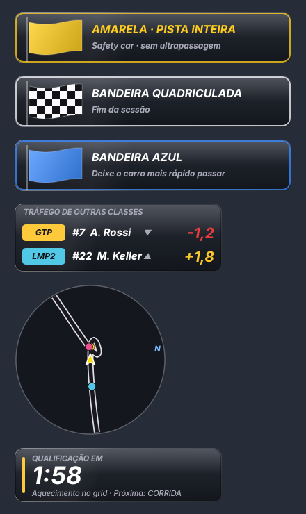

| Janela | Quando aparece | O que mostra |
|---|---|---|
| **Bandeiras** | só com bandeira | verde (6 s), amarela, amarela de pista inteira, azul, branca, quadriculada, preta/desclassificado, vermelha |
| **Tráfego** | só com carro de outra classe a até ~6 s | classe, #número, piloto e diferença em s (▼ atrás, ▲ à frente) |
| **Minimapa** | sempre | pista girando ao seu redor; carros na cor da classe; "N" = norte; alcance 150/260/400 m no menu |
| **Auxiliar** | antes da largada e no fim | etapa da sessão, contagem, duração; "também durante a sessão" mostra o tempo restante |

Destravadas (modo mover), as janelas automáticas mostram um exemplo para você posicionar. Os segundos do Tráfego são calculados (velocidade e distância na pista); o traçado do Minimapa é aprendido na primeira volta.

### Central de configurações (1.6.0)

Duplo clique no ícone da bandeja (ou "Abrir configurações…"):

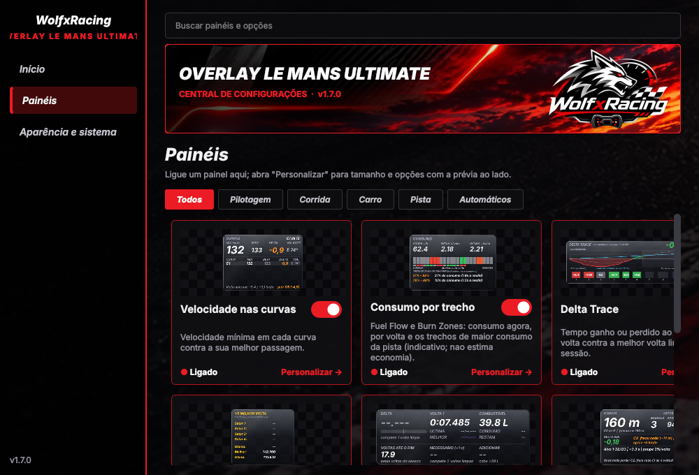

- **Elementos (build u):** os painéis *Curvas, Setores, Coach, Consumo, Tendência* e *Voltas* têm, em *Personalizar > ELEMENTOS*, um interruptor por parte da janela. Desligar uma parte encolhe a janela e sobe as partes de baixo; "Mostrar todos" restaura. A prévia ao lado mostra o resultado na hora. Em *Voltas*, as colunas desligadas ficam vazias (sem reaproveitar o espaço).
- **Painéis:** um cartão por janela com prévia, liga/desliga e "Personalizar"; busca e filtros por categoria.
- **Personalizar:** tamanho, opções do painel e prévia ao vivo.

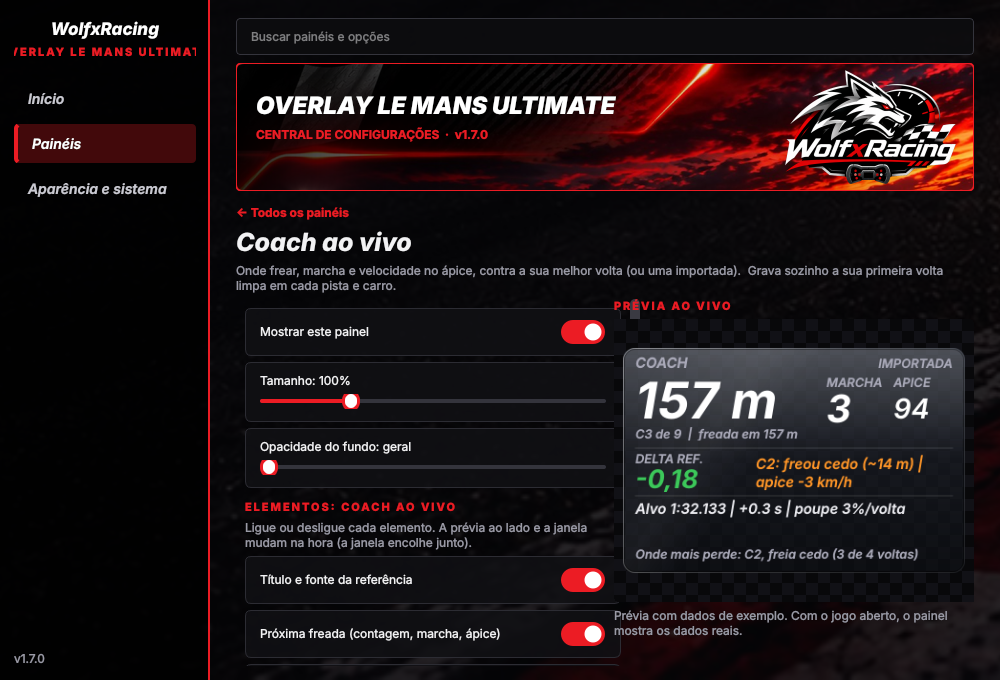

- **Aparência e sistema:** opacidade, vidro, travar posição, economia de CPU, prioridade, atalhos.

O menu da bandeja ficou curto; todas as opções antigas estão em "Todas as opções (avançado)".

### Último contato e Entrada do pit (1.6.0)

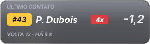

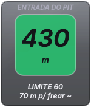

- **Último contato:** aparece depois que você toca em um carro; mostra o piloto, a volta, há quanto tempo e a diferença atual (− atrás, + à frente).
- **Entrada do pit:** verde → amarelo → vermelho (**FREIE**) conforme a distância de frenagem até o limite; na pit lane mostra a velocidade contra o limite e a distância até o box. A frenagem usa 1,2 g: é uma estimativa. A linha de entrada é aprendida quando você entra de verdade pelo pit (acima de 36 km/h, vindo da pista); nascer no box não conta. A janela aparece quando o jogo informa pedido de parada.

## 6. Como ler os números: medido, calculado, estimado

- **Medido pelo jogo** (sem marca): ABS e TC atuando, níveis (energia virtual, combustível, desgaste, temperaturas, pressão), composto, zonas de dano, bandeiras, boxes, penalidades.
- **"~"** = **calculado** pelo overlay: consumo por volta, alcance, janela de pit, alvo de consumo, ritmo, tendência, distâncias e tempos entre carros, limite dos boxes (o jogo não informa; o overlay anota a velocidade com o limitador ligado nos boxes e só mostra depois da 1ª passagem).
- O LMU **não informa**: o pneu dos outros carros e o pedido de pneu nos boxes (por isso a Estratégia não tem vantagem em s/volta), a superfície dos outros carros (Retorno), % de dano, tempo de reparo, tempo de parada planejado, previsão do tempo, país/iRating dos pilotos nem pneus/dano dos outros carros. Essas informações **não existem** no overlay (nada é inventado). Vento e neblina dependem de o jogo preencher o dado; sem ele aparece "--".
- A **vida do pneu** vem de `mWear` (100% = novo). Quando o jogo entrega exatamente **0,0** numa roda, o overlay trata como *sem leitura* e mostra "--" em vez de "0%".
- "Pista molhada" (1 a 7) e "céu" são **escalas do overlay** a partir de números do jogo: apoio visual, não medida oficial.

## 7. Dash e Stream Deck

- **Dash MagicDash 4 Glass Fumê ou Sport** (3 telas): veja [DASH.md](DASH.md).
- **Perfil de Stream Deck XL** (janelas, controles, iniciar/fechar, pasta Suporte): veja [STREAMDECK.md](STREAMDECK.md).

## 8. Solução de problemas

| Sintoma | O que fazer |
|---|---|
| Janelas não aparecem | O jogo está em **Window/Borderless** (e não Fullscreen)? *Enable Plugins* está ligado? Rode `diagnostico_lmu.bat`. |
| "Aguardando o Le Mans Ultimate..." | O overlay não achou a memória do jogo: jogo fechado, sem sessão ou *Enable Plugins* desligado. |
| Estado "incompatível" no log | O jogo foi atualizado e mudou o formato da memória. O overlay não mostra dados errados: abra uma Issue com o diagnóstico. |
| Amarela local acesa o tempo todo | Versões antigas tratavam o valor 11 como amarela; a versão atual só aceita 1 (confirmado em jogo real). |
| Vento/neblina "--" | O LMU não informa esses dados nesta estrutura. |
| Numero do carro em branco | O número sai do nome do veículo ("... #31"); mods fora do padrão podem ficar em branco. |
| Um atalho do Stream Deck não funciona | Outro programa pode estar usando a combinação; veja `overlay_log_lmu.txt`. |
| Valor estranho | Anote a janela e a situação e abra uma Issue com `diagnostico_lmu.txt` e `overlay_log_lmu.txt`. |

## 9. Atualizar para uma versão nova

1. Feche o overlay (*Sair* na bandeja).
2. Baixe o novo `.zip` e **copie por cima** da pasta atual (o `config*.json`, recordes, mapas e logs ficam e continuam valendo, pois não vêm no pacote).
3. Leia o [CHANGELOG](../CHANGELOG.md) para ver o que mudou. Reabra o overlay.

## 10. Limites conhecidos

- O pacote foi validado parcialmente no jogo real: leitura de dados, energia, pneus, delta, gaps, danos e alertas funcionaram; vento e neblina **não** são fornecidos pelo jogo. Veja `overlay/ROTEIRO_VALIDACAO_LMU.txt` para validar com o jogo.
- Tela cheia exclusiva (Fullscreen) esconde qualquer overlay (limitação do Windows).
- Se o LMU for atualizado e mudar o formato da memória compartilhada, o overlay detecta e se recusa a mostrar dados errados até ser atualizado.
- O numero e a marca do carro saem do nome do veículo; mods fora do padrão podem ficar sem número.

Mais detalhes técnicos de cada recurso: [`referencia/GUIA_ORIGINAL.txt`](referencia/GUIA_ORIGINAL.txt) (guia completo escrito durante o desenvolvimento).

### Classificação no layout de transmissão e versão EXE (1.6.1)

A janela Classificação ganhou o layout de tabela de transmissão: barra superior (sessão, volta, tempo, AIR/TRACK e número de carros) e as colunas POS, +/-, #, marca, DRIVER, selos PIT/PEN, GAP, INT, BEST, LAST, AVG 5, PIT e FUEL. Seu carro fica em roxo.

- **GAP e INT na corrida são estimativas** (posição na pista × tempo de volta típico da classe); em treino e qualificação são a diferença das melhores voltas.
- **GAP/INT** cinza com "~" são estimados (carro de outra classe no meio); **PIT** são as paradas informadas pelo jogo e **FUEL** o combustível de cada carro em %.
- Para voltar ao visual antigo, use `"classificacao_layout": "classico"` no `config.json`.
- **Versão EXE:** baixe `WolfxRacing_LMU_vX.Y.Z_EXE.zip` na release, extraia e abra `WolfxRacing_LMU.exe` (não precisa de Python). `testar_demo_exe.bat` abre em modo demonstração e `fechar_overlay_exe.bat` fecha à força. Para gerar no seu PC: `overlay\gerar_exe_lmu.bat`.

## Novidades da 1.7.0 (prints)

Coach ao vivo, Delta Trace (com o *ritmo ideal estimado*), Consumo, Curvas e Tendência, e a Central com **Elementos** liga/desliga e prévia ao vivo (imagens geradas com dados de exemplo).

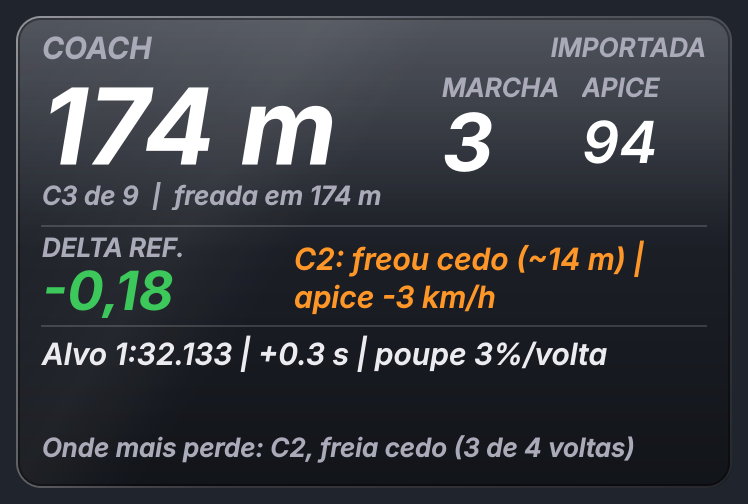

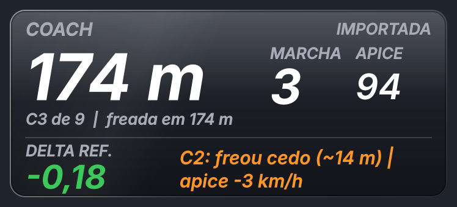

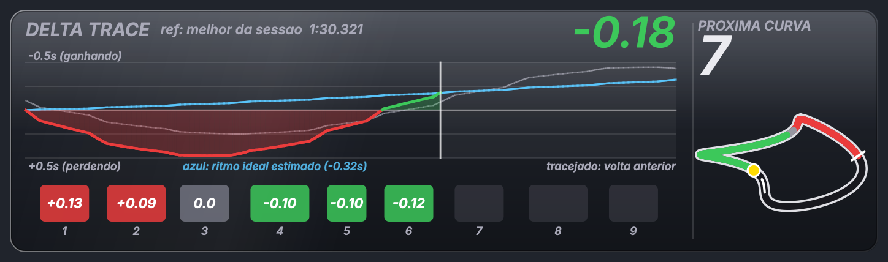

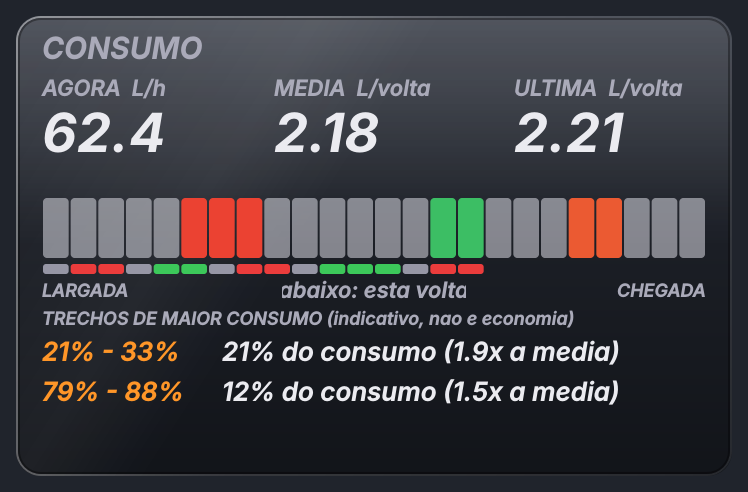

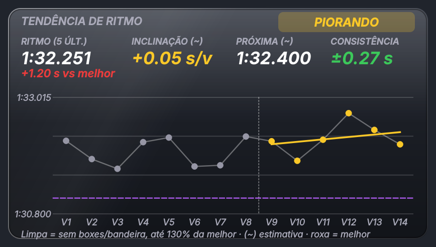

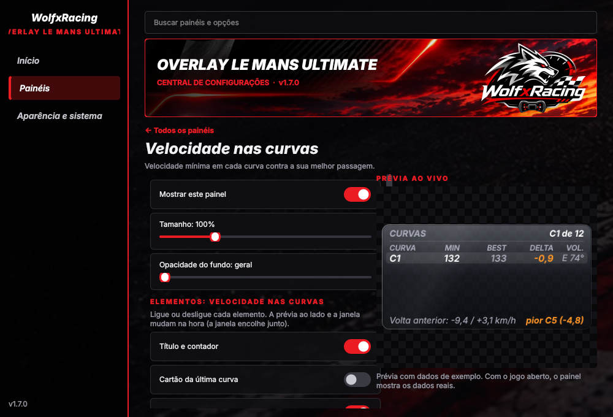
