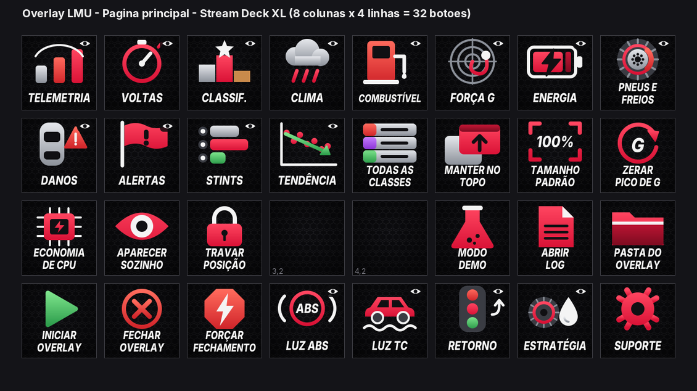
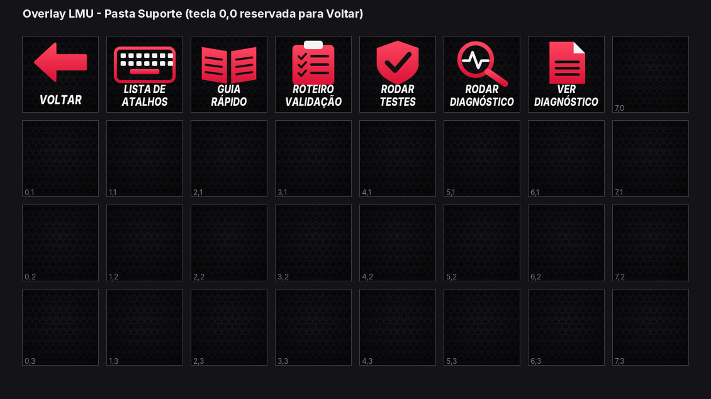

# Stream Deck XL: Le Mans Ultimate (LMU)

O overlay registra **atalhos globais** do Windows (teclas F13 a F24, que quase nenhum teclado tem, para não conflitar com o jogo) e cada um faz **exatamente o mesmo** que o item correspondente do menu da bandeja. O perfil do Stream Deck apenas aperta essas teclas (ação *Sistema > Hotkey*) e abre arquivos do pacote (iniciar, log, guia...).





## Importar o perfil

1. Abra o aplicativo do Stream Deck.
2. Clique no nome do perfil (canto superior esquerdo) > **Importar...** e escolha `streamdeck/Overlay LMU.streamDeckProfile`.
3. **Caminho da pasta:** as teclas que abrem arquivos usam o caminho `C:\WolfxRacing\wolfxracing-overlay-lmu\overlay`. Se você extraiu em **outro lugar**, rode antes:

```text
python streamdeck/ajustar_perfil.py "D:\Caminho\Do\overlay"
```

Isso cria `...\_ajustado.streamDeckProfile` com o seu caminho; importe esse arquivo.

4. O perfil foi feito para o **Stream Deck XL** (8 colunas x 4 linhas = 32 teclas).

## Atalhos

| Atalho | Função |
|---|---|
| `Ctrl+Shift+F13` | Mostrar/ocultar telemetria |
| `Ctrl+Shift+F14` | Mostrar/ocultar voltas (delta e combustível) |
| `Ctrl+Shift+F15` | Mostrar/ocultar classificação |
| `Ctrl+Shift+F16` | Mostrar/ocultar clima e chuva |
| `Ctrl+Shift+F17` | Mostrar/ocultar painel de combustível e pit |
| `Ctrl+Shift+F18` | Mostrar/ocultar força G |
| `Ctrl+Shift+F19` | Mostrar/ocultar energia virtual e combustível |
| `Ctrl+Shift+F20` | Mostrar/ocultar pneus e freios |
| `Ctrl+Shift+F21` | Mostrar/ocultar danos do carro |
| `Ctrl+Shift+F22` | Mostrar/ocultar alertas na pista |
| `Ctrl+Shift+F23` | Mostrar/ocultar histórico de stints |
| `Ctrl+Shift+F24` | Mostrar/ocultar tendência de ritmo |
| `Alt+Shift+F13` | Modo economia de CPU (liga/desliga) |
| `Alt+Shift+F14` | Aparecer sozinho ao entrar no carro (liga/desliga) |
| `Alt+Shift+F15` | Travar posição das janelas (liga/desliga) |
| `Alt+Shift+F16` | Zerar o pico de G |
| `Alt+Shift+F17` | Classificação: mostrar todas as classes (liga/desliga) |
| `Alt+Shift+F18` | Manter o overlay por cima do jogo (liga/desliga) |
| `Alt+Shift+F19` | Restaurar o tamanho das janelas (100%) |
| `Alt+Shift+F20` | **Fechar** o overlay |
| `Alt+Shift+F21` | Mostrar/ocultar luz do ABS |
| `Alt+Shift+F22` | Mostrar/ocultar luz do TC |
| `Alt+Shift+F23` | Mostrar/ocultar retorno à pista |
| `Alt+Shift+F24` | Mostrar/ocultar estratégia de pneus |

- A lista é gerada a partir da tabela `ATALHOS_LMU` de `overlay/ov_atalhos_lmu.py`. As combinações são **diferentes** das do overlay de iRacing, então os dois perfis convivem sem colisão. O LMU não tem perfis Treino/Classificação/Corrida.
- Os atalhos só funcionam com o **overlay aberto** e funcionam com o jogo em primeiro plano.
- Se uma combinação já for usada por outro programa, o overlay avisa na bandeja e registra no log quais atalhos não foram registrados; os demais continuam funcionando.
- Para desligar tudo: bandeja > desmarque *Teclas de atalho para o Stream Deck* (fica salvo).
- Limite: o Stream Deck **não lê o estado** do overlay. O botão alterna (liga/desliga), mas o ícone não muda sozinho; confira olhando a tela.
- Sub-opções dentro de cada janela e outros itens do menu da bandeja **não** têm atalho global.

## Regenerar ícones e perfil

Os ícones (144x144) e o perfil são gerados por scripts em [`streamdeck/gerador`](../streamdeck/gerador) a partir da tabela de atalhos do próprio overlay (nenhum comando é inventado nos scripts). Veja o `mapa_comandos*.md` para o mapa completo (posição das teclas x atalho x ícone). Os ícones são desenhos originais do projeto.
